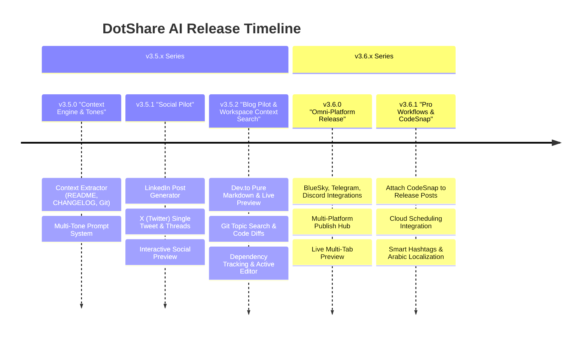

# 🗺️ DotShare AI — Release & Update Intelligence Roadmap

> **Feature Name:** DotShare AI (Release & Update Publishing)\
> **Milestone Series:** `v3.5.x` → `v3.6.x`\
> **Brand & Philosophy:** Powered by the **DotSuite / DotShare** brand. One-click context extraction from your codebase (`README`, `CHANGELOG`, `Git`), multi-tone AI content generation, real-time live preview, and platform-tailored publishing.

---

## 🧭 Version Milestones Overview



---

## 📦 v3.5.0 — "Context Engine & Multi-Tone Core"
> **Focus:** Lay the groundwork with robust context extraction from local workspace files and a flexible multi-tone prompt generation engine.\
> **Status:** ✅ Completed

### 🎯 Key Deliverables
- [x] **`src/services/ProjectContextService.ts`**:
  - `parseChangelog()`: Extract latest release version heading, categorized bullets (Features, Fixes, Breaking Changes).
  - `parseReadme()`: Extract project title, one-line summary, primary stack, and repository URL.
  - `getGitContext()`:
    - Last commit message (`git log -1 --pretty=%B`).
    - Recent commits summary (`git log -n 5 --oneline`).
    - Unstaged/Staged diff overview (`git diff --stat`).
- [x] **`src/ai/prompts/ReleasePromptBuilder.ts`**:
  - Implement system prompts for **5 distinct tones & styles**:
    1. **👔 Professional & Formal:** Business-centric, value/impact focused (LinkedIn / Corporate).
    2. **🚀 Build in Public / Casual:** Engaging, story-telling, developer journey (X / BlueSky).
    3. **🧠 Technical Deep-Dive:** Architecture, performance metrics, code specifics.
    4. **⚡ TL;DR & Bulletins:** Fast scannable bullet points for instant consumption.
    5. **📝 Full Technical Article:** Strictly **Pure Markdown** for blogs with code fences and headers.
  - Multi-language generation support (English & Arabic).
- [x] **AI Provider Integration**:
  - Connect the new prompt builder to all 4 supported providers: Google Gemini, Anthropic Claude, OpenAI GPT-4o, and xAI Grok.

---

## 📦 v3.5.1 — "Social Pilot (LinkedIn & 𝕏) & Dynamic Discovery"
> **Focus:** Platform-by-platform validation starting with the two largest developer social platforms, complete with character limits, dynamic AI discovery, and Smart CTA Hub.\
> **Status:** ✅ Completed

### 🎯 Key Deliverables
- [x] **𝕏 (Twitter) Generator**:
  - Standard Tweet Mode: Enforce 280-character limit with smart hook.
  - Thread Generator Mode: Splits release notes into 3–6 numbered tweets (`1/n`, `2/n`...) with a strong introductory hook and concluding call-to-action.
  - X Premium support (up to 25,000 characters).
- [x] **LinkedIn Generator**:
  - Structured formatting with clear paragraphs, professional tech emojis, bullet lists, and CTA links.
  - Auto-strip markdown syntax unsupported by LinkedIn (convert `# Heading` to readable caps/bold unicode).
- [x] **Interactive Social Preview**:
  - Live card preview showing the post styled as a LinkedIn feed item or 𝕏 tweet/thread.
  - In-place text editor for manual tweaks before sending.
- [x] **Smart CTA & Dynamic Discovery**:
  - Real-time multi-panel sync, repo auto-detection, and official modern SDK migrations (`@google/genai`, Responses API).

---

## 📦 v3.5.2 — "Blog Pilot (Dev.to - Pure Markdown)"
> **Focus:** Automated long-form article generation formatted strictly in valid Markdown with metadata.\
> **Status:** ✅ Completed

### 🎯 Key Deliverables
- [x] **Dev.to Article Generator:**
  - Auto-generates full-length technical release blog posts.
  - **Strict Pure Markdown Rule:** AI outputs only valid GitHub Flavored Markdown (headings `##`, lists `-`, code blocks with language tags ` ```ts `).
- [x] **YAML Frontmatter Builder:**
  - Auto-populates frontmatter:
    ```markdown
    ---
    title: Release v3.5: DotShare AI for Developers
    published: false
    tags: vscode, ai, opensource, webdev
    canonical_url: https://github.com/kareem2099/DotShare
    ---
    ```
- [x] **Markdown Live Preview & Editor:**
  - Segmented tabbed editor (`✏️ Raw Markdown` / `👁️ Live Preview`) with real-time rendered HTML and syntax-highlighted code blocks via `marked`.
  - Live metadata stats (word count, char count, estimated reading time).
  - Direct 1-click publishing or saving as draft to Dev.to.

---

## 📦 v3.5.3 — "Context as Data Search & Workspace Intelligence"
> **Focus:** Elevate workspace context from static heuristic scraping into an on-demand, query-driven code & git search engine.\
> **Status:** ✅ Completed

### 🎯 Key Deliverables
- [x] **Query-Driven Topic Search (`searchGitByTopic`):**
  - Searches commit messages (`git log --grep`) and pickaxe code diffs (`git log -S`) matching the user's custom topic or prompt.
  - Injects high-relevance commits into prompt context instead of generic logs.
- [x] **Semantic Diff & Code Snippet Extraction (`extractRelevantCodeSnippets`):**
  - Extracts targeted source code hunks related to the user's focus topic or primary changes.
  - Strict bounded token allocation (concise 12-15 line snippets) preventing prompt bloat and hallucination.
- [x] **Dependency Diff Engine (`getDependencyChanges`):**
  - Tracks added/updated dependencies from `package.json` and `Cargo.toml`.
  - Provides exact library version changes to the LLM.
- [x] **Multi-Ecosystem Manifests:**
  - Full metadata and stack auto-detection for Rust (`Cargo.toml`), Python (`pyproject.toml`), Go (`go.mod`), and Node.js (`package.json`).
- [x] **Active Editor Working Context (`getActiveEditorContext`):**
  - Seamlessly bridges the developer's open file and active selection into the AI prompt context.
- [x] **Workspace Docs & Architecture Search (`searchWorkspaceDocs`):**
  - Scans workspace markdown files (`docs/**`, `*.md`) for topic-relevant architecture insights.

---

## 📦 v3.6.0 — "Omni-Platform Hub & Full UI Wizard"
> **Focus:** Scale to all remaining platforms and launch the unified Release Control Center UI.

### 🎯 Key Deliverables
- [ ] **Multi-Platform Adapters:**
  - **🦋 BlueSky:** 300-grapheme limit handling, auto-facet detection for links/tags, and thread creation.
  - **💬 Discord:** Formatted Rich Embeds with colored status bands and structured fields for announcements.
  - **📱 Telegram:** Telegram Markdown V2 / HTML formatted messages with inline buttons.
- [ ] **Unified Webview Wizard Panel (`DotShareWebView`):**
  - **Step 1:** Select context sources (`[x] CHANGELOG`, `[x] Git Commits`, `[ ] README`).
  - **Step 2:** Select target platforms (Multi-select: `LinkedIn`, `X`, `BlueSky`, `Dev.to`, `Discord`, `Telegram`).
  - **Step 3:** Choose tone (`Professional` / `Casual` / `Deep-Dive` / `TL;DR` / `Article`) and language.
  - **Step 4:** **Live Multi-Tab Preview:** Switch between platform previews, edit content independently per platform, and click **«🚀 Publish All»** or **«Publish Selected»**.
- [ ] **Tone Switcher & Regenerator:**
  - One-click button to regenerate specific platform content with an alternate tone without re-analyzing the workspace.

---

## 📦 v3.6.1 — "Pro Workflows, CodeSnap Integration & Polish"
> **Focus:** Rich media attachments, cloud scheduling integration, and smart optimizations.

### 🎯 Key Deliverables
- [ ] **📸 CodeSnap Attachment Integration:**
  - Direct bridge between `CodeSnapPanel` and **DotShare AI**.
  - Automatically suggest capturing a code snapshot for highlighted changes in the release and attach it to the post composer.
- [ ] **📅 Cloud Scheduler Integration:**
  - Schedule release posts across multiple platforms via the DotSuite Rust backend (`SchedulerClient`).
- [ ] **🏷️ Smart Hashtag Engine:**
  - Automatically match tech stack keywords from `README` (e.g. `#TypeScript`, `#Rust`, `#VSCode`) and append optimized tags.
- [ ] **🌍 Comprehensive Localization:**
  - Full Arabic and English support across prompts, generated content, and UI labels.

---

## 💻 Technical Types & Architecture

```typescript
// src/types/release-copilot.ts (or src/types/dotshare-ai.ts)

export type ReleaseSourceType = 'changelog' | 'readme' | 'git_commits' | 'git_diff' | 'manual';

export type PostTone =
  | 'professional'
  | 'casual_build_in_public'
  | 'technical_deep_dive'
  | 'tldr_bulletin'
  | 'full_markdown_article';

export type TargetPlatform = 'linkedin' | 'x' | 'bluesky' | 'devto' | 'discord' | 'telegram';

export interface ProjectReleaseContext {
  projectName: string;
  projectDescription?: string;
  version?: string;
  changelogNotes?: string[];
  recentCommits?: string[];
  gitDiffSummary?: string;
  repoUrl?: string;
}

export interface ReleaseGenerationRequest {
  context: ProjectReleaseContext;
  targetPlatforms: TargetPlatform[];
  tone: PostTone;
  language: 'en' | 'ar';
  includeHashtags: boolean;
  includeCodeSnippets: boolean;
}

export interface GeneratedPlatformContent {
  platform: TargetPlatform;
  rawContent: string;
  formattedPreview?: string;
  charCount: number;
  isThread?: boolean;
  threadParts?: string[];
  frontmatter?: Record<string, any>; // Dev.to YAML
}
```

---

## 📊 Version Milestone Checklist

| Version | Milestone Name | Status | Estimated Sprints |
|---|---|:---:|---|
| **v3.5.0** | Context Engine & Multi-Tone Core | ✅ Completed | Sprint 1 |
| **v3.5.1** | Social Pilot (LinkedIn & 𝕏 Threads) | ✅ Completed | Sprint 2 |
| **v3.5.2** | Blog Pilot (Dev.to Pure Markdown) | ✅ Completed | Sprint 3 |
| **v3.6.0** | Omni-Platform Hub & Full UI Wizard | ⏳ UP NEXT | Sprint 4 |
| **v3.6.1** | CodeSnap Bridge & Cloud Scheduling | 🔵 Planned | Sprint 5 |

---

*Document created for DotShare project. Compatible with DotShare v3.4.1+ architecture.*
